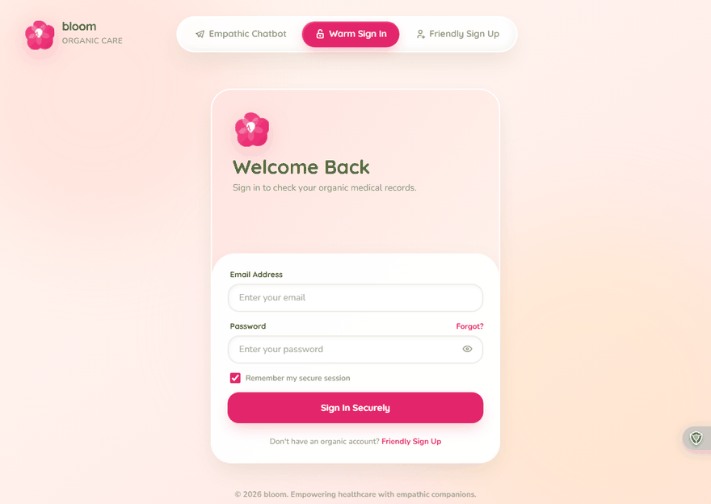
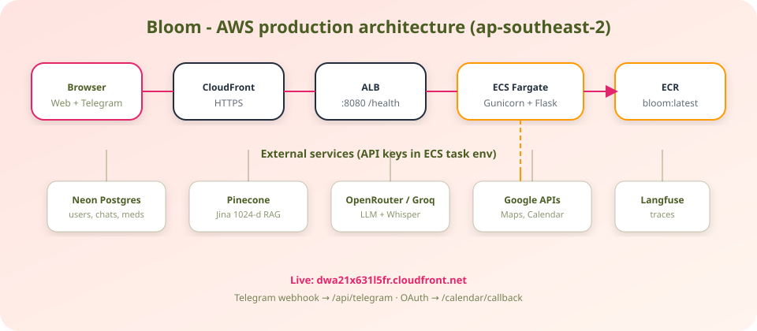

<div align="center">

<!-- Vector wordmark: same logo paths as static/brand/bloom-logo.svg + login header type -->
<p align="center">
  <a href="https://dwa21x631l5fr.cloudfront.net">
    
  </a>
</p>

<h3><em>Listen first. Cite always. Care nearby.</em></h3>
<p>India-first health companion on the web and Telegram — empathic chat, medicine context, maps, labs, and voice.</p>

<br/>

<a href="https://dwa21x631l5fr.cloudfront.net">
  
</a>
&nbsp;&nbsp;
<a href="https://t.me/bloom531134_bot">
  
</a>

<br/><br/>

| | |
|---|---|
| **Web** | https://dwa21x631l5fr.cloudfront.net |
| **Telegram** | https://t.me/bloom531134_bot |
| **Health** | https://dwa21x631l5fr.cloudfront.net/health |
| **Webhook** | `https://dwa21x631l5fr.cloudfront.net/api/telegram` |
| **Calendar OAuth** | `https://dwa21x631l5fr.cloudfront.net/calendar/callback` |

<br/>

[](https://python.org)
[](https://flask.palletsprojects.com)
[](https://langchain-ai.github.io/langgraph/)
[](https://aws.amazon.com/ecs/)
[](https://aws.amazon.com/cloudfront/)
[](https://neon.tech)
[](https://pinecone.io)
[](https://langfuse.com)
[](LICENSE)

</div>

---

> **Disclaimer:** Educational only — not diagnosis or prescribing. Emergency: **112**, **108**, Tele-MANAS **14416**.

---

## Demo preview

<p align="center">
  
</p>

<p align="center">
  <a href="https://dwa21x631l5fr.cloudfront.net"><strong>Open live app</strong></a>
  &nbsp;·&nbsp;
  <a href="https://t.me/bloom531134_bot"><strong>Message on Telegram</strong></a>
</p>

---

## What bloom does

| Module | What users get |
|--------|----------------|
| **Chat** | Safety triage → LangGraph route → cited RAG answers |
| **Meds** | India monographs — composition, warnings, interactions, freshness |
| **Care map** | Hospitals, doctors, pharmacies (Google Maps / Places) |
| **Labs** | PDF upload → plain-language explanation |
| **Appointments** | Call script + reminders (assisted, not clinic API booking) |
| **Voice** | Browser Web Speech + Groq Whisper on uploads |
| **Telegram** | Same orchestration via webhook |
| **Share / PDF** | 7-day share links + visit PDF (ReportLab) |

---

## Production architecture

<p align="center">
  
</p>

[Open full SVG](docs/diagrams/architecture.svg)

---

## System design (one chat turn)

<p align="center">
  
</p>

[Open full SVG](docs/diagrams/system-design.svg)

---

## Complete technology stack

Everything used in this repository, grouped by layer.

### Language & runtime

| Tech | Where |
|------|--------|
| **Python 3.11** | `Dockerfile`, `runtime.txt`, local dev |
| **pip** | `requirements.txt` |

### Web application

| Tech | Where |
|------|--------|
| **Flask 3** | `app.py`, routes |
| **Jinja2** | `templates/` |
| **Werkzeug** | `ProxyFix` in production (`app.py`) |
| **Gunicorn** | `gunicorn.conf.py`, `Dockerfile` (gthread workers) |
| **WSGI** | `wsgi.py` |
| **Tailwind CSS** (CDN) | `templates/base.html` |
| **Custom CSS** (clay UI) | `static/style.css` |
| **Google Fonts** — Quicksand, Nunito Sans | `base.html` |
| **Tabler Icons** | templates |
| **Font Awesome 6** | `base.html` |
| **Web Speech API** | `templates/chat.html` — `speechSynthesis`, `webkitSpeechRecognition` (en-IN) |

### Auth, sessions, limits

| Tech | Where |
|------|--------|
| **Flask-Login** | `app.py` |
| **Flask-Bcrypt** / **bcrypt** | `models.py` |
| **Flask-Limiter** | `app.py`, `config.py` |
| **email-validator** | signup validation |
| **Secure session cookies** | `ProductionConfig` |

### Database & ORM

| Tech | Where |
|------|--------|
| **Flask-SQLAlchemy** | `models.py` |
| **SQLAlchemy** | engine options, migrations in `db_setup.py` |
| **psycopg2-binary** | Neon / Postgres (`config.py` → `postgresql+psycopg2://`) |
| **SQLite** | local dev when `DATABASE_URL` unset |
| **Neon PostgreSQL** | production (`DATABASE_URL`, pooled endpoint) |
| **SQLAlchemy NullPool** | production Postgres (`config.py`) |

### AI orchestration

| Tech | Where |
|------|--------|
| **LangGraph** | `orchestration/graphs/main.py` supervisor |
| **LangChain** | `langchain`, `langchain-core`, `langchain-community` |
| **LangChain OpenAI** | OpenRouter via `ChatOpenAI` (`src/llm_providers.py`) |
| **LangChain Groq** | `ChatGroq` fallback |
| **LangChain Pinecone** | `tools/rag.py`, `store_index.py` |
| **LangChain text splitters** | `store_index.py` indexing |
| **LangChain HuggingFace** | listed in requirements; **not used for live embeddings** (Jina-only 1024-d) |
| **LCEL-style chains** | retriever + prompt patterns in graphs |
| **TypedDict graph state** | `orchestration/state.py` |

### Embeddings & vector search

| Tech | Where |
|------|--------|
| **Jina AI API** | `jina-embeddings-v3`, **1024 dimensions** (`src/embeddings.py`) |
| **Pinecone** | index `medicalbot`, serverless (`tools/rag.py`, `store_index.py`) |
| **Semantic top-k retrieval** | `tools/rag.py` |

### Large language models & speech

| Tech | Model / endpoint | Where |
|------|------------------|--------|
| **OpenRouter** | `openai/gpt-oss-120b:free` | primary LLM |
| **Groq** | `openai/gpt-oss-120b` | LLM fallback |
| **Groq Whisper** | `whisper-large-v3-turbo` (env override) | `services/voice.py` uploads |
| **OpenAI Whisper** | `whisper-1` | optional fallback in `voice.py` |

### External APIs & integrations

| Service | Purpose |
|---------|---------|
| **Google Maps JavaScript API** | `templates/map.html` |
| **Google Places API** (Nearby Search + Details) | `tools/places.py` |
| **Google OAuth 2.0** | Calendar readonly — `services/calendar.py` |
| **Telegram Bot API** | webhook `POST /api/telegram`, `telegram_handler.py`, `setup_webhook.py` |
| **Langfuse** | traces `bloom.turn` — `services/observability.py` |
| **OpenTelemetry** | Flask instrumentation + OTLP HTTP — `services/telemetry.py` |
| **Upstash Redis** (optional) | `RATELIMIT_STORAGE_URI` / `UPSTASH_REDIS_URL` |
| **Amazon S3 / S3-compatible (R2)** (optional) | `services/storage.py` via **boto3** |

### Documents & ingestion

| Tech | Where |
|------|--------|
| **pypdf** | lab PDF read (`routes/platform.py`) |
| **ReportLab** | visit PDF export (`services/pdf_export.py`) |
| **PyYAML** | `ingestion/sources.yaml` |
| **Local JSON catalog** | `Data/medicines/india_seed.json`, `safety_notices.json` |
| **Ingest pipeline** | `ingestion/pipeline.py`, `worker/jobs.py` |
| **PDF book indexing** | `store_index.py` + `Data/` PDFs |

### Data models (Postgres / SQLite)

`User`, `Conversation`, `Message` (citations, risk, trace, intent), `UserHealthProfile`, `UserMedication`, `DrugMonograph`, `UserFavoritePlace`, `UploadedDocument`, `LabResult`, `AppointmentRequest`, `IngestJob`, `Feedback`, `ShareToken`, `Notification` — `models.py`

### Observability & ops

| Tech | Where |
|------|--------|
| **Langfuse Python SDK** | `langfuse>=2.0` |
| **OpenTelemetry API / SDK** | `services/telemetry.py` |
| **opentelemetry-instrumentation-flask** | auto-instrument when OTLP endpoint set |
| **opentelemetry-exporter-otlp-proto-http** | optional export |
| **Python logging** | app + modules |
| **CloudWatch Logs** | ECS task `/ecs/bloom` |

### AWS production (live)

| Service | Role |
|---------|------|
| **Amazon ECR** | `bloom:latest` container |
| **Amazon ECS Fargate** | cluster `bloom`, service `bloom-web` |
| **Application Load Balancer** | public HTTP → targets :8080 |
| **Amazon CloudFront** | `dwa21x631l5fr.cloudfront.net` |
| **AWS IAM** | `bloom-ecs-execution`, `bloom-apprunner-ecr` roles |
| **VPC / public subnets / security groups** | ECS tasks |
| **PowerShell deploy script** | `deploy/aws.ps1` |

### Container & config

| Tech | Where |
|------|--------|
| **Docker** | `Dockerfile` (python:3.11-slim-bookworm, non-root user) |
| **python-dotenv** | `.env` loading |
| **requests** | HTTP clients (voice, places, telegram setup) |

### Alternate / legacy deploy path

| Tech | Where |
|------|--------|
| **Vercel Serverless** | `vercel.json`, `api/index.py` (not used for current AWS live URL) |

### Testing & quality

| Tech | Where |
|------|--------|
| **unittest** | `tests/evals/test_platform.py` |
| **Eval cases JSON** | `tests/evals/cases.json` |

## Run locally

```powershell
python -m venv .venv
.\.venv\Scripts\Activate.ps1
pip install -r requirements.txt
copy .env.example .env
python app.py
```

```powershell
pytest tests/evals/test_platform.py
```

---

## Deploy (AWS Sydney)

```powershell
.\deploy\aws.ps1
aws ecs update-service --cluster bloom --service bloom-web --force-new-deployment --region ap-southeast-2
```

---

## License

MIT — [LICENSE](LICENSE)

<div align="center">

**[Live](https://dwa21x631l5fr.cloudfront.net)** · **[Telegram](https://t.me/bloom531134_bot)** · **[GitHub](https://github.com/keshav-077/medical-chatbot-rag)**

© 2026 bloom — Empowering healthcare with empathic companions

</div>
