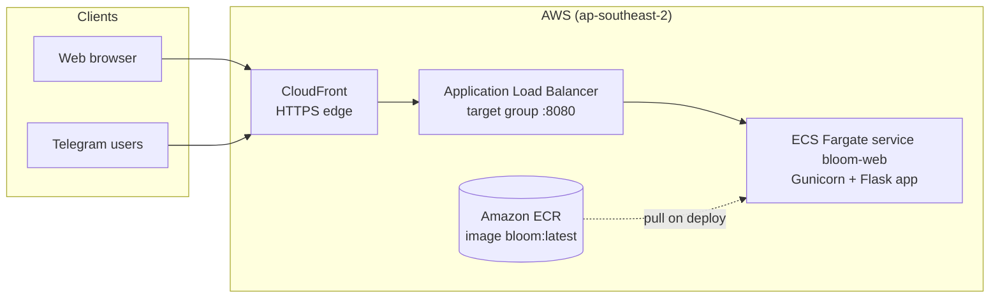
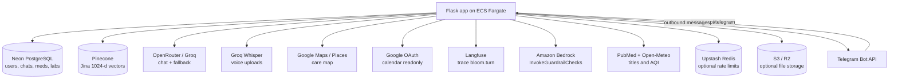
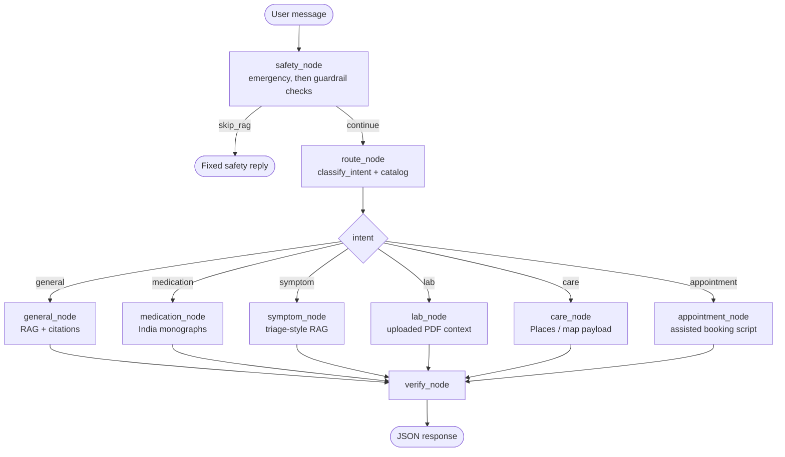
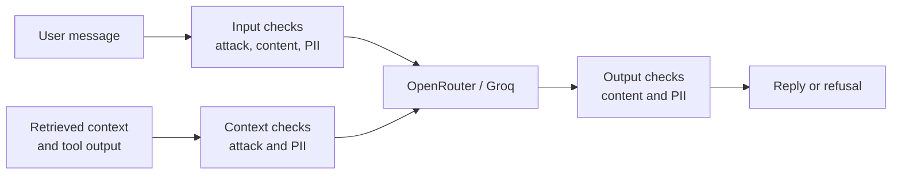

<div align="center">

<a href="https://dwa21x631l5fr.cloudfront.net">

</a>

<p>India-first health companion on the web and Telegram — chat with citations, medicine context, care map, labs, and voice.</p>

<a href="https://dwa21x631l5fr.cloudfront.net">
  
</a>
&nbsp;&nbsp;
<a href="https://t.me/bloom531134_bot">
  
</a>

<br/><br/>

| | |
|---|---|
| **Web** | https://dwa21x631l5fr.cloudfront.net |
| **Telegram** | https://t.me/bloom531134_bot |
| **Health** | https://dwa21x631l5fr.cloudfront.net/health |
| **Webhook** | `https://dwa21x631l5fr.cloudfront.net/api/telegram` |
| **Calendar OAuth** | `https://dwa21x631l5fr.cloudfront.net/calendar/callback` |

<br/>

[](https://python.org)
[](https://flask.palletsprojects.com)
[](https://langchain-ai.github.io/langgraph/)
[](https://aws.amazon.com/ecs/)
[](https://aws.amazon.com/cloudfront/)
[](https://neon.tech)
[](https://pinecone.io)
[](https://langfuse.com)
[](https://docs.aws.amazon.com/bedrock/latest/userguide/guardrails-use-invoke-guardrail-checks.html)
[](LICENSE)

</div>

---

> **Disclaimer:** Educational only — not diagnosis or prescribing. Emergency: **112**, **108**, Tele-MANAS **14416**.

---

## Demo preview

<p align="center">
  
</p>

<p align="center">
  <a href="https://dwa21x631l5fr.cloudfront.net"><strong>Open live app</strong></a>
  &nbsp;·&nbsp;
  <a href="https://t.me/bloom531134_bot"><strong>Message on Telegram</strong></a>
</p>

---

## What Bloom does

| Module | What users get |
|--------|----------------|
| **Chat** | Emergency screen, then guardrail checks, then a LangGraph route and cited RAG answers |
| **Guardrails** | Bedrock `InvokeGuardrailChecks` on user text, retrieved context, tool output, and the model reply. Local fallback for prompt attacks and identifier redaction |
| **Meds** | India monographs — composition, warnings, interactions, PubMed titles, freshness |
| **Care map** | Hospitals, doctors, pharmacies (Google Maps / Places) |
| **Labs** | PDF upload → plain-language explanation |
| **Appointments** | Call script + reminders (assisted, not clinic API booking) |
| **Voice** | Browser Web Speech + Groq Whisper on uploads |
| **Telegram** | Same orchestration via webhook |
| **Missions** | After a turn: visit pack, med card, interaction huddle, lab review, weekly digest |
| **MCP tools** | In-process FastMCP tools for drugs, library search, care, AQI, PubMed, and profile |
| **Share / PDF** | 7-day share links + visit PDF (ReportLab) |

---

## Production architecture

Live region: **ap-southeast-2 (Sydney)** · URL: **https://dwa21x631l5fr.cloudfront.net**

### Traffic path



Vector source: [`docs/diagrams/architecture.svg`](docs/diagrams/architecture.svg).

| Hop | Component | Role |
|-----|-----------|------|
| 1 | **CloudFront** | TLS termination, CDN in front of the ALB |
| 2 | **ALB** | Routes HTTP to healthy Fargate tasks; **`GET /health`** for checks |
| 3 | **ECS Fargate** | Runs the Docker image: Flask routes, LangGraph, webhooks |
| 4 | **ECR** | Stores **`bloom:latest`**; `deploy/aws.ps1` builds and pushes |

### App ↔ external services

All third-party credentials are injected as **ECS task environment variables** (from your secrets / `.env` in deploy).



| Service | Used for |
|---------|----------|
| **Neon Postgres** | Accounts, conversations, medications, uploads, appointments, share tokens |
| **Pinecone** | Semantic retrieval over indexed medical PDFs (`store_index.py`, Jina embeddings) |
| **OpenRouter / Groq** | LLM turns in LangGraph nodes; Groq also for Whisper transcription |
| **Google Places** | Nearby hospitals, doctors, pharmacies on the care map |
| **Google Calendar OAuth** | Callback **`/calendar/callback`** for reminder scheduling |
| **Langfuse** | End-to-end **`bloom.turn`** and **`bloom.mission`** traces (optional OTLP via OpenTelemetry) |
| **Amazon Bedrock Guardrails** | `InvokeGuardrailChecks` in **ap-southeast-2**. Detect-only scores; the app blocks, redacts, or allows. No guardrail resource to create |
| **PubMed E-utilities** | Title search on medication answers (`mcp_bloom/sources/pubmed.py`) |
| **Open-Meteo** | Air quality on respiratory symptom turns (`mcp_bloom/sources/aqi.py`) |
| **Telegram** | Same orchestration as web via webhook **`/api/telegram`** |

### Deploy shape (summary)

| Piece | Name / note |
|-------|-------------|
| Cluster | `bloom` |
| Service | `bloom-web` |
| Container port | **8080** |
| Logs | CloudWatch **`/ecs/bloom`** |
| Deploy script | `deploy/aws.ps1` + `aws ecs update-service --force-new-deployment` |

---

## System design (one chat turn)

Web chat uses **`POST /get`**; Telegram uses **`POST /api/telegram`**. Both call **`run_turn()`** in `orchestration/graphs/main.py` and share the same LangGraph.

### LangGraph supervisor



Vector source: [`docs/diagrams/system-design.svg`](docs/diagrams/system-design.svg).

| Stage | Node | What it does |
|-------|------|----------------|
| **1. Safety** | `safety_node` | Emergency regex first (crisis text skips the guardrail). Then Amazon Bedrock **`InvokeGuardrailChecks`** for prompt attack, content, and sensitive information, with a local fallback. May set **`skip_rag`**. |
| **2. Route** | `route_node` | **`classify_intent()`** or forced intent from client; uses drug catalog names when relevant |
| **3. Specialist** | One of six nodes | Retrieves context (Pinecone, DB, Places, PDF text), calls LLM with node-specific prompts |
| **4. Verify** | `verify_node` | Citation checks, dose guardrails, output guardrail check, freshness badges; normalizes payload |

Guardrail checkpoints around the model call. Emergency text never reaches these checks.



| Check | Categories | App action |
|-------|------------|------------|
| **Prompt attack** | Jailbreak, prompt injection, prompt leakage | Block at score **0.6** |
| **Content** | Hate, insults, sexual, violence, misconduct | Block at **0.8**. On input, violence and insults stay open so injury descriptions are not dropped. Context and tool text are not content-filtered |
| **Sensitive information** | Email, phone, cards, keys, passwords, government and bank ids, plus local Aadhaar groups | Redact at confidence **0.6** before the third-party model call |

Bedrock is used when `BEDROCK_GUARDRAILS_ENABLED=1` or when the task has AWS credentials. Otherwise local patterns still block obvious prompt attacks and redact identifiers. Content scores require Bedrock.

### Specialist intents

| Intent | Typical triggers | Main data sources |
|--------|------------------|-------------------|
| **general** | Open health questions | Pinecone RAG, conversation history |
| **medication** | Drug names, doses, interactions | `DrugMonograph`, seed catalog, RAG, PubMed, safety notices |
| **symptom** | “I feel…”, symptom lists | RAG, Open-Meteo AQI for respiratory symptoms |
| **lab** | “Explain my report” | User’s uploaded PDF text (`UploadedDocument` / lab flow) |
| **care** | “Hospital near me” | Google Places, favorites, **`map_payload`** for UI |
| **appointment** | Booking help | Templates + calendar context (assisted, not clinic API) |

### Response contract

After **`verify`**, the API returns JSON consumed by the web UI and Telegram formatter:

| Field | Meaning |
|-------|---------|
| **`answer`** | Markdown-safe reply text |
| **`citations`** | Source snippets / metadata shown in the UI |
| **`risk_level`** | Triage hint from safety + verify |
| **`map_payload`** | Optional care-map markers and place details |
| **`trace_id`** | Langfuse / debug correlation id |
| **`intent`** | Routed specialist (for analytics and UI chips). **`guardrail`** when the input check blocks the turn |
| **`guardrail_action`** | `allow`, `redact`, or `block` |

Observability: **`start_trace("bloom.turn", …)`** wraps each invocation when Langfuse is configured.

---

## Complete technology stack

Everything used in this repository, grouped by layer.

### Language & runtime

| Tech | Where |
|------|--------|
| **Python 3.11** | `Dockerfile`, `runtime.txt`, local dev |
| **pip** | `requirements.txt` |

### Web application

| Tech | Where |
|------|--------|
| **Flask 3** | `app.py`, routes |
| **Jinja2** | `templates/` |
| **Werkzeug** | `ProxyFix` in production (`app.py`) |
| **Gunicorn** | `gunicorn.conf.py`, `Dockerfile` (gthread workers) |
| **WSGI** | `wsgi.py` |
| **Tailwind CSS** (CDN) | `templates/base.html` |
| **Custom CSS** (clay UI) | `static/style.css` |
| **Google Fonts** — Quicksand, Nunito Sans | `base.html` |
| **Tabler Icons** | templates |
| **Font Awesome 6** | `base.html` |
| **Web Speech API** | `templates/chat.html` — `speechSynthesis`, `webkitSpeechRecognition` (en-IN) |

### Auth, sessions, limits

| Tech | Where |
|------|--------|
| **Flask-Login** | `app.py` |
| **Flask-Bcrypt** / **bcrypt** | `models.py` |
| **Flask-Limiter** | `app.py`, `config.py` |
| **email-validator** | signup validation |
| **Secure session cookies** | `ProductionConfig` |

### Database & ORM

| Tech | Where |
|------|--------|
| **Flask-SQLAlchemy** | `models.py` |
| **SQLAlchemy** | engine options, migrations in `db_setup.py` |
| **psycopg2-binary** | Neon / Postgres (`config.py` → `postgresql+psycopg2://`) |
| **SQLite** | local dev when `DATABASE_URL` unset |
| **Neon PostgreSQL** | production (`DATABASE_URL`, pooled endpoint) |
| **SQLAlchemy NullPool** | production Postgres (`config.py`) |

### AI orchestration

| Tech | Where |
|------|--------|
| **LangGraph** | `orchestration/graphs/main.py` supervisor |
| **LangChain** | `langchain`, `langchain-core`, `langchain-community` |
| **LangChain OpenAI** | OpenRouter via `ChatOpenAI` (`src/llm_providers.py`) |
| **LangChain Groq** | `ChatGroq` fallback |
| **LangChain Pinecone** | `tools/rag.py`, `store_index.py` |
| **LangChain text splitters** | `store_index.py` indexing |
| **LangChain HuggingFace** | listed in requirements; **not used for live embeddings** (Jina-only 1024-d) |
| **TypedDict graph state** | `orchestration/state.py` (`guardrail_action` included) |
| **Amazon Bedrock Guardrails** | `orchestration/guardrails.py` — `InvokeGuardrailChecks` via **boto3** |
| **FastMCP** | `mcp` package, `mcp_bloom/server.py` |
| **CrewAI / AutoGen** | optional mission runners; sequential `complete()` when those packages are absent |

### Agentic safety

| Piece | Where |
|-------|--------|
| **Emergency regex** | `orchestration/safety.py` — runs before any guardrail check |
| **InvokeGuardrailChecks** | User input, retrieved context, tool arguments and output, model reply |
| **Local fallback** | Prompt-attack phrases, email, phone, Aadhaar groups, card numbers (Luhn), cloud keys |
| **Dose strip** | `verify_node` removes an invented “take N mg” when that dose is not in retrieved context |
| **Lab huddle review** | `missions/huddles/safety_review.py` rejects diagnosis, dosing, and start/stop language |
| **IAM** | `bedrock:InvokeGuardrailChecks` on `*` in **ap-southeast-2**. The API is resourceless |

### Missions and tools

| Piece | Where |
|-------|--------|
| **Mission queue** | `Mission` model, `missions/enqueue.py`, `missions/runner.py` |
| **Visit pack, med card, digest** | `missions/crews/` |
| **Lab review, interaction huddle** | `missions/huddles/` |
| **MCP tool registry** | `mcp_bloom/registry.py` — same functions the graph calls |
| **PubMed** | `mcp_bloom/sources/pubmed.py` |
| **Open-Meteo AQI** | `mcp_bloom/sources/aqi.py` |
| **India safety notices** | `mcp_bloom/sources/notices.py`, `Data/medicines/safety_notices.json` |

### Embeddings & vector search

| Tech | Where |
|------|--------|
| **Jina AI API** | `jina-embeddings-v3`, **1024 dimensions** (`src/embeddings.py`) |
| **Pinecone** | index `medicalbot`, serverless (`tools/rag.py`, `store_index.py`) |
| **Semantic top-k retrieval** | `tools/rag.py` |

### Large language models & speech

| Tech | Model / endpoint | Where |
|------|------------------|--------|
| **OpenRouter** | `openai/gpt-oss-120b:free` | primary LLM |
| **Groq** | `openai/gpt-oss-120b` | LLM fallback |
| **Groq Whisper** | `whisper-large-v3-turbo` (env override) | `services/voice.py` uploads |
| **OpenAI Whisper** | `whisper-1` | optional fallback in `voice.py` |

### External APIs & integrations

| Service | Purpose |
|---------|---------|
| **Google Maps JavaScript API** | `templates/map.html` |
| **Google Places API** (Nearby Search + Details) | `tools/places.py` |
| **Google OAuth 2.0** | Calendar readonly — `services/calendar.py` |
| **Telegram Bot API** | webhook `POST /api/telegram`, `telegram_handler.py`, `setup_webhook.py` |
| **Langfuse** | traces `bloom.turn` — `services/observability.py` |
| **OpenTelemetry** | Flask instrumentation + OTLP HTTP — `services/telemetry.py` |
| **Upstash Redis** (optional) | `RATELIMIT_STORAGE_URI` / `UPSTASH_REDIS_URL` |
| **Amazon S3 / S3-compatible (R2)** (optional) | `services/storage.py` via **boto3** |
| **Amazon Bedrock Runtime** | `InvokeGuardrailChecks` in `orchestration/guardrails.py` |
| **NCBI E-utilities** | PubMed title search |
| **Open-Meteo Air Quality API** | Respiratory symptom context |

### Documents & ingestion

| Tech | Where |
|------|--------|
| **pypdf** | lab PDF read (`routes/platform.py`) |
| **ReportLab** | visit PDF export (`services/pdf_export.py`) |
| **PyYAML** | `ingestion/sources.yaml` |
| **Local JSON catalog** | `Data/medicines/india_seed.json`, `safety_notices.json` |
| **Ingest pipeline** | `ingestion/pipeline.py`, `worker/jobs.py` |
| **PDF book indexing** | `store_index.py` + `Data/` PDFs |

### Data models (Postgres / SQLite)

`User`, `Conversation`, `Message` (citations, risk, trace, intent), `UserHealthProfile`, `UserMedication`, `DrugMonograph`, `UserFavoritePlace`, `UploadedDocument`, `LabResult`, `AppointmentRequest`, `IngestJob`, `Feedback`, `ShareToken`, `Notification`, `Mission` — `models.py`

### Observability & ops

| Tech | Where |
|------|--------|
| **Langfuse Python SDK** | `langfuse>=2.0` |
| **OpenTelemetry API / SDK** | `services/telemetry.py` |
| **opentelemetry-instrumentation-flask** | auto-instrument when OTLP endpoint set |
| **opentelemetry-exporter-otlp-proto-http** | optional export |
| **Python logging** | app + modules |
| **CloudWatch Logs** | ECS task `/ecs/bloom` |

### AWS production (live)

| Service | Role |
|---------|------|
| **Amazon ECR** | `bloom:latest` container |
| **Amazon ECS Fargate** | cluster `bloom`, service `bloom-web` |
| **Application Load Balancer** | public HTTP → targets :8080 |
| **Amazon CloudFront** | `dwa21x631l5fr.cloudfront.net` |
| **Amazon Bedrock** | Guardrail checks only (`bedrock:InvokeGuardrailChecks`). No guardrail resource |
| **AWS IAM** | `bloom-ecs-execution`, `bloom-apprunner-ecr` roles |
| **VPC / public subnets / security groups** | ECS tasks |
| **PowerShell deploy script** | `deploy/aws.ps1` |

### Container & config

| Tech | Where |
|------|--------|
| **Docker** | `Dockerfile` (python:3.11-slim-bookworm, non-root user) |
| **python-dotenv** | `.env` loading |
| **requests** | HTTP clients (voice, places, PubMed, Open-Meteo, telegram setup) |
| **boto3 ≥ 1.43** | S3 uploads and Bedrock `InvokeGuardrailChecks` |

### Alternate / legacy deploy path

| Tech | Where |
|------|--------|
| **Vercel Serverless** | `vercel.json`, `api/index.py` (not used for current AWS live URL) |

### Testing & quality

| Tech | Where |
|------|--------|
| **unittest** | `tests/evals/test_platform.py`, `tests/evals/test_guardrails.py` |
| **Eval cases JSON** | `tests/evals/cases.json` |

## Run locally

```powershell
python -m venv .venv
.\.venv\Scripts\Activate.ps1
pip install -r requirements.txt
copy .env.example .env
python app.py
```

```powershell
pytest tests/evals/test_platform.py
```

---

## Deploy (AWS Sydney)

```powershell
.\deploy\aws.ps1
aws ecs update-service --cluster bloom --service bloom-web --force-new-deployment --region ap-southeast-2
```

On the ECS task, set `BEDROCK_GUARDRAILS_ENABLED=1` and `BEDROCK_GUARDRAILS_REGION=ap-southeast-2`. The task role needs `bedrock:InvokeGuardrailChecks` on `*`. Without that permission the app keeps the local prompt-attack and redaction checks and logs that Bedrock was skipped.

---

## License

MIT — [LICENSE](LICENSE)

---

<div align="center">

<h3><em>Empathic guidance. Every answer cited.</em></h3>

<a href="https://dwa21x631l5fr.cloudfront.net">
  
</a>
&nbsp;
<a href="https://t.me/bloom531134_bot">
  
</a>

<br/><br/>

<a href="https://dwa21x631l5fr.cloudfront.net/health">Health check</a>
&nbsp;·&nbsp;
<a href="https://github.com/keshav-077/medical-chatbot-rag">Source code</a>
&nbsp;·&nbsp;
<a href="https://dwa21x631l5fr.cloudfront.net/login">Sign in</a>

<br/><br/>

<strong>Bloom</strong> · Organic Care<br/>
© 2026 Bloom — Empowering healthcare with empathic companions

</div>
